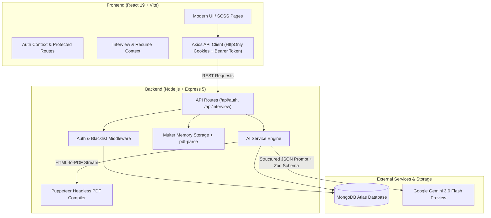

# 🚀 Resume-GenAI — AI Resume Analyzer & Interview Preparation Platform

[](https://react.dev/)
[](https://nodejs.org/)
[](https://expressjs.com/)
[](https://www.mongodb.com/)
[](https://ai.google.dev/)
[](https://zod.dev/)
[](https://pptr.dev/)

**Resume-GenAI** is an intelligent, full-stack career platform designed to help job candidates evaluate their role readiness, uncover missing technical skills, prepare for targeted technical/behavioral interviews, and automatically generate tailored, ATS-optimized PDF resumes.

---

## 📌 Table of Contents

- [Core Capabilities](#-core-capabilities)
- [Empirical Evaluation & Benchmark (Evals)](#-empirical-evaluation--benchmark-evals)
- [📖 User Manual / How to Use](#-user-manual--how-to-use)
- [System Architecture](#-system-architecture)
- [Tech Stack](#-tech-stack)
- [Project Structure](#-project-structure)
- [Getting Started](#-getting-started)
- [Environment Variables](#-environment-variables)
- [API Reference](#-api-reference)
- [License](#-license)

---

## ✨ Core Capabilities

- **📄 In-Memory Resume Ingestion:** Streams uploaded PDF resumes with `multer` and extracts raw content via `pdf-parse` without saving unneeded binary files to server disk.
- **🎯 Role-Match Scoring:** Calculates a calibrated 0–100 match score evaluating the candidate's actual qualifications against the target Job Description (JD).
- **🔍 Skill Gap Analysis:** Automatically isolates missing technologies or competencies and tags them with severity levels (`high`, `medium`, `low`).
- **📅 Personalized Day-by-Day Roadmaps:** Synthesizes structured, actionable preparation plans customized to the candidate's detected technical gaps.
- **❓ Targeted Interview Question Bank:** Curates domain-specific technical and behavioral questions accompanied by interviewer intent and recommended model answers.
- **🖨️ Headless ATS Resume Generator:** Dynamically creates clean, semantic HTML resumes and compiles them into downloadable A4 PDF documents using headless **Puppeteer**.
- **🔐 Secure Authentication:** Implements JWT-based sessions stored in HttpOnly cookies, Bearer token authorization, bcrypt password hashing, and database-backed token blacklisting for secure logout.

---

## 📊 Empirical Evaluation & Benchmark (Evals)

To verify system reliability and eliminate hallucination, the AI pipeline was evaluated across an automated benchmark harness containing **12 diverse ground-truth test cases** (spanning exact role matches, stack pivots, level mismatches, and domain gaps).

| Evaluation Metric | Measured Result | Benchmark Standard |
| :--- | :---: | :--- |
| **Schema Compliance Pass Rate** | **91.7%** (11/12) | Strict validation against Zod schema contracts |
| **Field-Level Extraction Accuracy** | **100.0%** (66/66) | All core fields present and structurally valid |
| **Skill Gap Detection Recall** | **91.7%** (11/12) | Accurately identifies primary missing requirements |
| **False Positive Hallucination Rate** | **0.0%** (0 errors) | Existing candidate skills are never misflagged |
| **Score Calibration Accuracy** | **83.3%** (10/12) | Calibrated score bounds (e.g., MERN: 95%, Mismatch: 2%) |
| **Average Response Latency** | **16.32s** | End-to-end LLM inference and structured JSON parsing |
| **PDF Generation Throughput** | **~86 KB / 24s** | Headless Chrome compilation to downloadable A4 PDF |

---

## 📖 User Manual / How to Use

Follow this step-by-step guide to get the most out of **Resume-GenAI**:

### Step 1: Create an Account & Log In
1. Navigate to the **Register** page.
2. Enter your **Username**, **Email**, and **Password** (use the eye icon toggle to show/hide your password).
3. Click **Register**. You will be redirected to the **Login** page with a confirmation message.
4. Enter your credentials and click **Login** to enter your dashboard.

### Step 2: Enter Job Description
1. On the **Home** dashboard, paste the target Job Description (JD) into the **Target Job Description** textarea.
2. Ensure you include the key skills, experience level, and role expectations from the employer.

### Step 3: Provide Your Profile Details
You have two flexible ways to provide your profile:
* **Option A (Recommended):** Upload your current PDF resume using the drag-and-drop file uploader.
* **Option B:** Type a quick summary in the **Quick Self-Description** box detailing your technical stack, projects, and years of experience.

### Step 4: Generate Your Custom Interview Report
1. Click the **Generate Interview Plan** button.
2. The AI will evaluate your profile against the job description and present:
   * **Match Score:** A calibrated percentage (0–100%) showing how closely your profile fits the role.
   * **Skill Gaps:** Missing or weak skills flagged with severity indicators (`High`, `Medium`, or `Low`).
   * **Day-by-Day Preparation Plan:** Structured, daily study topics and actionable tasks to close your skill gaps.
   * **Technical & Behavioral Questions:** Real interview questions with the interviewer's hidden intent and suggested answer approaches.

### Step 5: Export Tailored ATS Resume
1. In your report view, click the **Download Tailored Resume** button.
2. The platform will automatically convert your tailored resume into an ATS-friendly, professional A4 PDF ready for job applications.

---

## 🏗️ System Architecture



---

## 🛠️ Tech Stack

### **Frontend**
- **Framework:** React 19 (Hooks, Context API, Modular Feature Architecture)
- **Tooling:** Vite 8, React Router 8
- **Styling:** SCSS, Responsive Layouts, Utility Modules
- **HTTP Client:** Axios (Interceptors for Bearer token & cookie support)

### **Backend**
- **Runtime:** Node.js (v20+)
- **Server Framework:** Express.js (v5)
- **Database / ODM:** MongoDB Atlas, Mongoose
- **AI SDK:** `@google/genai` (Google Gemini 3.0 Flash Preview)
- **Validation:** Zod, `zod-to-json-schema`
- **File Ingestion:** Multer (Memory Storage), `pdf-parse`
- **PDF Generation:** Puppeteer (Headless Chromium)
- **Security:** JSON Web Tokens (JWT), Bcrypt.js, Cookie-Parser, CORS

---

## 📁 Project Structure

```text
Resume-GenAI/
├── Backend/
│   ├── src/
│   │   ├── config/             # Database connection setup
│   │   ├── controllers/        # Auth & Interview request handlers
│   │   ├── middlewares/        # JWT auth verification, file upload
│   │   ├── models/             # Mongoose schemas (User, InterviewReport, Blacklist)
│   │   ├── routes/             # Express API route declarations
│   │   ├── services/           # Gemini AI prompting, Zod schemas, Puppeteer PDF
│   │   └── app.js              # Express app configuration & middleware
│   ├── .env                    # Environment variables (ignored by Git)
│   ├── .gitignore              # Backend ignore rules
│   ├── package.json            # Backend dependencies & scripts
│   └── server.js               # Entry point listening on dynamic PORT
├── Frontend/
│   ├── public/                 # Static assets & SVG icons
│   ├── src/
│   │   ├── features/
│   │   │   ├── Auth/           # Login, Register, Auth Context, useAuth hook
│   │   │   └── interview/      # Home, Report, PDF Viewer, interview context
│   │   ├── styles/             # Modular SCSS styling
│   │   ├── App.jsx             # Main application layout
│   │   ├── app.routes.jsx      # Application client-side routing
│   │   └── main.jsx            # React root mount
│   ├── .gitignore              # Frontend ignore rules
│   ├── package.json            # Frontend dependencies & scripts
│   ├── vercel.json             # Single-Page Application (SPA) redirect configuration
│   └── vite.config.js          # Vite build pipeline setup
└── README.md                   # Project documentation
```

---

## ⚡ Getting Started

### Prerequisites
- Node.js (v18 or higher recommended)
- MongoDB Atlas cluster URL or local MongoDB instance
- Google Gemini API Key ([Get one here](https://aistudio.google.com/))

### 1. Clone the Repository
```bash
git clone https://github.com/eleshkapri/Resume-GenAI.git
cd Resume-GenAI
```

### 2. Backend Setup
```bash
cd Backend
npm install
```

Create a `.env` file in the `Backend` directory:
```env
PORT=3000
MONGO_URI=your_mongodb_connection_string
JWT_SECRET=your_jwt_secret_key
GOOGLE_GENAI_API_KEY=your_gemini_api_key
CLIENT_URL=http://localhost:5173
```

Start the backend development server:
```bash
npm run dev
```

### 3. Frontend Setup
In a new terminal window:
```bash
cd ../Frontend
npm install
npm run dev
```
Open `http://localhost:5173` in your browser.

---

## 🔑 Environment Variables

| Variable | Description | Location |
| :--- | :--- | :--- |
| `PORT` | Dynamic server listening port (Default: `3000`) | `Backend/.env` |
| `MONGO_URI` | MongoDB Atlas database connection URI | `Backend/.env` |
| `JWT_SECRET` | Secret key used to sign and verify JWT authentication tokens | `Backend/.env` |
| `GOOGLE_GENAI_API_KEY` | Google Gemini API Key powering AI generation | `Backend/.env` |
| `CLIENT_URL` | Allowed client origin for CORS requests | `Backend/.env` |
| `VITE_API_URL` | Live backend API URL for frontend Axios calls | `Frontend` (Vercel) |

---

## 📡 API Reference

### Authentication Endpoints (`/api/auth`)

| Method | Endpoint | Access | Description |
| :--- | :--- | :---: | :--- |
| `POST` | `/api/auth/register` | Public | Register a new user |
| `POST` | `/api/auth/login` | Public | Authenticate existing user credentials |
| `POST` | `/api/auth/logout` | Public | Invalidate and blacklist the current JWT session |
| `GET` | `/api/auth/get-me` | Private | Retrieve profile data for currently logged-in user |

### Interview & Resume Endpoints (`/api/interview`)

| Method | Endpoint | Access | Description |
| :--- | :--- | :---: | :--- |
| `POST` | `/api/interview/` | Private | Upload resume PDF, self-description, and JD to generate report |
| `GET` | `/api/interview/report/:interviewId` | Private | Fetch a single generated interview report by ID |
| `GET` | `/api/interview/` | Private | List all past interview reports for the authenticated user |
| `POST` | `/api/interview/resume/pdf/:interviewReportId` | Private | Generate and download an ATS-friendly A4 PDF resume |

---

## 📄 License

This project is licensed under the [ISC License](LICENSE).
